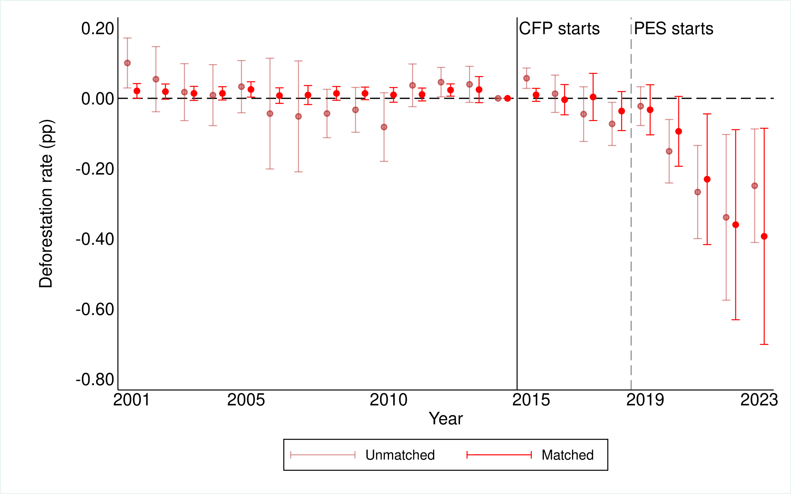
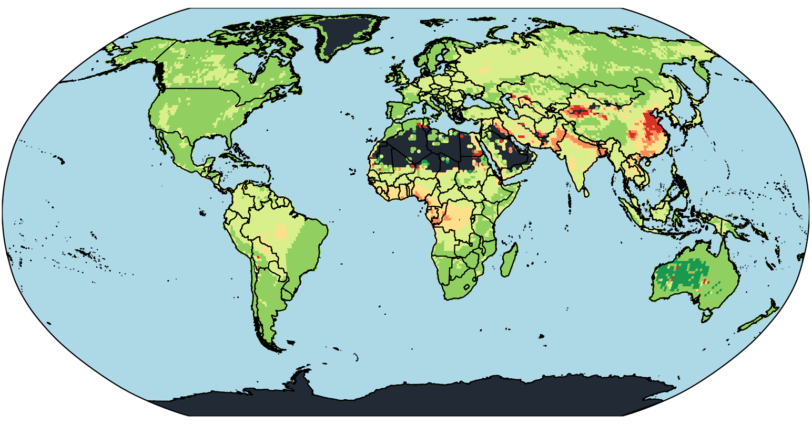
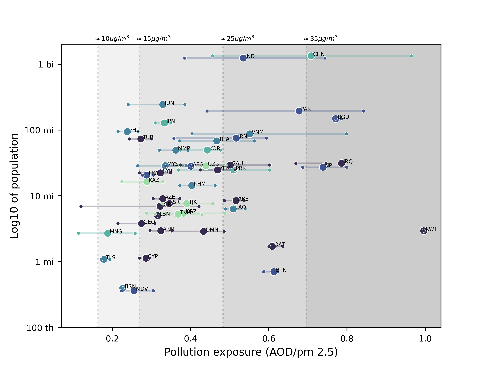
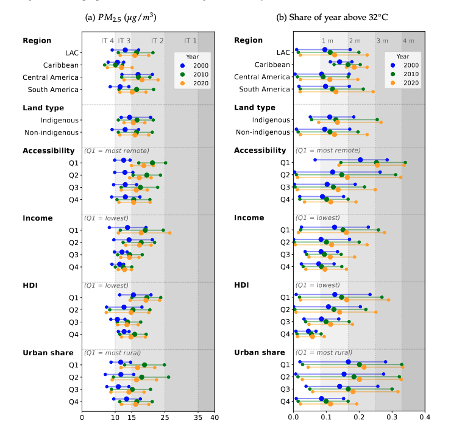
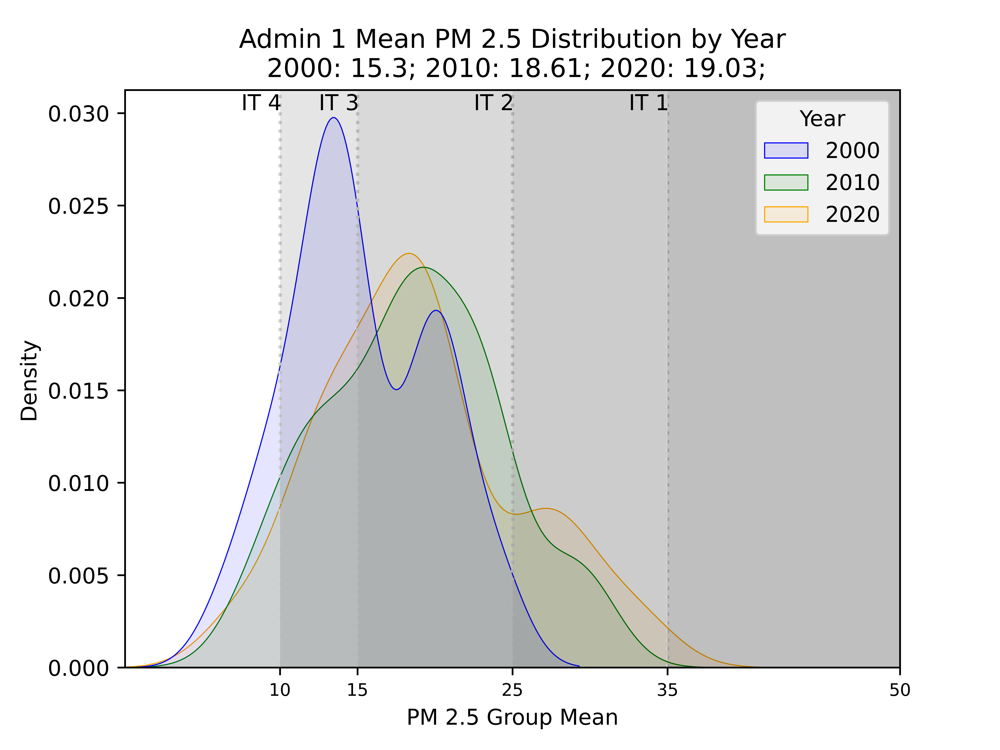
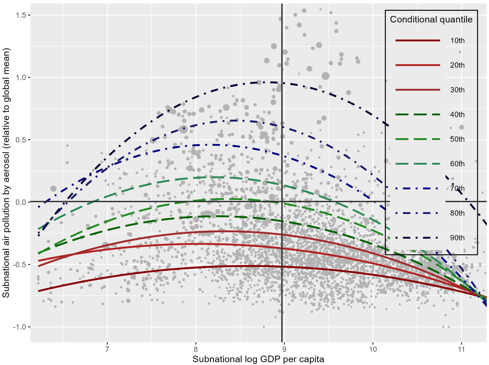
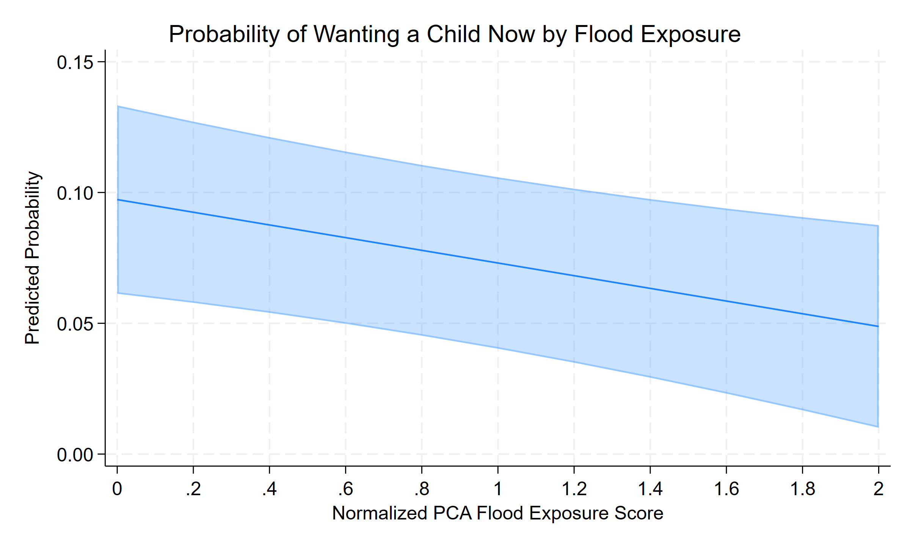

# Working Papers

---

[A Strategic Environment: 
\ 
\
Community Conservation, Site Selection, and Spillovers in Eastern Zambia]{style="font-weight: 700; font-size: 14pt;"}
 
[Revise and Resubmit, Journal of the Association of Environmental and Resource Economists (JAERE)]{style="font-weight: 700; font-size: 10pt;"}

::: {.column-margin}
{fig-align="center"}
:::

[[Draft](research/paper1/paper_zambia.pdf)]{style="font-weight: 900; font-size: 12pt;"} 

<!-- :::{.callout-tip icon=false  appearance="minimal" collapse="true" style="border: none; color: #196c19;"} -->

:::{.callout-tip icon=false  appearance="minimal" collapse="true"} 

# Abstract

[
 I evaluate the environmental impacts of a USAID-funded conservation project in Eastern Zambia that established Conservation Areas within Participating Chiefdom boundaries. Using satellite and administrative data at the 1 km × 1 km grid level from 2001 to 2023, I employ a Difference-in-Differences design with   propensity-score-matched controls to estimate effects on deforestation across two spatial margins: (i) Conservation Areas and Communal Lands within Participating Chiefdoms, and (ii) areas close to and far from  conservation boundaries within Non-Participating Chiefdoms. For Participating Chiefdoms, I found that tree cover loss fell by 0.14–0.16 percentage points within Conservation Areas, with no evidence of deforestation leakage into adjacent Communal Lands. For Non-Participating Chiefdoms, areas close to conservation boundaries exhibit spillover reductions of 0.17–0.19 percentage points in tree cover, and no effects for far areas. In hectares, the sum of these effects corresponds to yearly avoided deforestation of 753-866 ha and 6,777-7,794 ha from 2015 to 2023. Heterogeneity analysis reveals that conservation effects were stronger in areas closer to roads and human settlements. I also document spatial selection bias by showing that Conservation Areas were disproportionately placed in remote,  low-deforestation locations, indicating that communities selected areas where the opportunity cost of conservation is lowest. These findings suggest that the aggregate impact of community-based conservation programs depends critically on spatial targeting and the extent to which incentives diffuse beyond formally designated boundaries..]{style="font-size: 12pt;"}

:::

 

[Air Pollution Burden Around the World: 
 
Distributions, Inequalities, and the Economic Benefits of Clean Air]{style="font-weight: 700; font-size: 14pt;"}
 
[with Jere Behrman, Emily Hannum, Oscar Morales, and Fan Wang]{style="font-weight: 700; font-size: 10pt;"}

::: {.column-margin}
{fig-align="center"}
<!-- {fig-align="center"} -->
:::

[[Draft](research/paper1/paper_global_pollution.pdf)]{style="font-weight: 900; font-size: 12pt;"}  &emsp; [[Poster](research/gpp/afdossan_poster_pollution.pdf)]{style="font-weight: 900; font-size: 12pt;"} 

<!-- [[Poster](papers/gpp/Poster_PAA.pdf) - [Best Poster award PAA 2024](https://www.populationassociation.org/paa2024/poster-winners)]{style="font-weight: 900; font-size: 10pt;"} -->

:::{.callout-tip icon=false appearance="minimal" collapse="true"}

# Abstract

[We construct a globally harmonized, high-resolution dataset combining satellite-based aerosol optical depth (AOD) and population data to document global inequalities in air pollution exposure. By weighting pollution by population shares, we provide one of the first comprehensive assessments of how exposure to air pollution by aerosols varies across and within countries and regions. We find large disparities: populations in Asia face average exposure levels more than three times higher than those in Oceania, and within-country inequalities reach up to 359\%. Our analysis reveals compounding inequalities—regions with higher pollution also tend to be poorer, with double-ratio metrics indicating that environmental disadvantage amplifies economic inequality. Finally, we provide the first Global Compensating Equivalent Variation (CEV) estimate for clean air, finding that welfare gains from cleaner air exceed 10\% of GDP in many highly polluted areas, underscoring the significant economic and social returns from targeted pollution abatement policies. ]{style="font-size: 12pt;"}

::: 

 

[Air Pollution and Extreme Heat Exposures for Young Children in Latin America and the Caribbean]{style="font-weight: 700; font-size: 14pt;"}
 
[with Jere R. Behrman, Emily Hannum, Oscar Morales, and Fan Wang]{style="font-weight: 700; font-size: 10pt;"}

::: {.column-margin}
{fig-align="center"}
<!-- {fig-align="center"} -->
:::

[[Draft](research/paper1/lac_draft.pdf)]{style="font-weight: 900; font-size: 12pt;"} &emsp; [[Poster](research/lac/afdossan_poster_LAC.pdf)]{style="font-weight: 900; font-size: 12pt;"} 

<!-- [[Draft](papers/gpp/paper_global_pollution.pdf)]{style="font-weight: 900; font-size: 10pt;"}  -->

:::{.callout-tip icon=false appearance="minimal" collapse="true"}

# Abstract

[Air pollution and extreme heat pose important risks to human health and wellbeing, and children are particularly vulnerable to these hazards. We analyze how ambient exposures to these hazards are distributed across, and overlap with, the young child population of Latin America and the Caribbean. We then compare ambient exposure across socioeconomic and geographic groups. Using multiple satellite and administrative datasets available between 2000 and 2020, we analyze changes over time in the overlap between these groups and ambient hazards. Our findings highlight substantial increases in the mean and, in absolute terms, in the dispersion of ambient exposures from 2000 to 2020. Compared with 2000, in 2020 an additional 7.9 million children were exposed to air pollution above $10 \mu g/m^{3}$, the World Health Organization limit for safe exposure until 2021. For heat stress, 3.5 million additional children were exposed to a Universal Thermal Climate Index (UTCI) above 32°C for at least 3 months of the year. Beyond increases in single-hazard ambient exposures, we find growing compound exposures. In 2020, 4.3 million children (9.2\% of the child population) were exposed to both $PM_{2.5}$ above $15 \mu g/m^{3}$ and at least 3 months of extreme heat, 3.2 million more than in 2000. Moreover, higher exposures overlap with more socioeconomically disadvantaged regions (low-income and low-Human Development Index), and we document differences associated with geospatial groups, such as remoteness, rurality, and Indigenous land status. These findings show that ambient exposure compounds socioeconomic disadvantage and threatens young children’s health and wellbeing.
]{style="font-size: 12pt;"}

 

::: 

 

[Unfolding the Greener Path:
A Global Subnational Analysis of the Environmental
Kuznets Curve]{style="font-weight: 700; font-size: 14pt;"}
 
[with Oscar Morales, Jere R. Behrman, Emily Hannum, and Fan Wang]{style="font-weight: 700; font-size: 10pt;"}

::: {.column-margin}
{fig-align="center"}
:::

[[Draft](research/paper1/ekc_draft.pdf)]{style="font-weight: 900; font-size: 12pt;"}  

:::{.callout-tip icon=false appearance="minimal" collapse="true"}

# Abstract

[This paper provides the first global subnational analysis of the Environmental Kuznets Curve (EKC), relating GDP per capita and air pollution by aerosol. We use satellite data for Aerosol Optical Depth (AOD), a proxy for air pollution, and merge it with subnational GDP per capita for 2010 and population estimates. Our polynomial and quantile regressions confirm a robust inverted U-shaped relationship between income and pollution globally. However, we find significant heterogeneity across the air pollution distribution, with lower pollution quantiles exhibiting a flatter curve than higher pollution ones. Estimated Pollution-GDP elasticities confirm the overall EKC trend globally, with poorer regions exhibiting positive elasticities, while richer regions show negative magnitudes. However, considerable variation exists within regions, emphasizing that the development-pollution trajectory is not uniform.]{style="font-size: 12pt;"}

 
:::

 

[ Dynamic Fertility Intentions in the Aftermath of a Flood]{style="font-weight: 700; font-size: 14pt;"}
 
[with  Leticia J. Marteleto, Alexandre Gori Maia]{style="font-weight: 700; font-size: 10pt;"}

::: {.column-margin}
{fig-align="center"}
:::

[[Draft coming soon...]()]{style="font-weight: 900; font-size: 12pt;"}  

:::{.callout-tip icon=false appearance="minimal" collapse="true"}

# Abstract

[In this paper, we examine how fertility intentions evolved in response to a weather shock. We leverage spatiotemporal variation in exposure to and impact of a massive flash flood that occurred during panel surveys in 2020 and 2021, using a population-based sample of 2,520 women aged 18–34 across 94 municipalities in Pernambuco, Brazil. We use individual fixed-effects regressions to examine whether exposure to and impact of the 2022 flood are associated with changes in women’s fertility intentions, net of time-varying sociodemographic factors. We find important differences between exposure and impact. Findings show that traditional contextual measures of exposure to flood do not change fertility intentions, but a more nuanced measure that captures flood impact and resilience at the individual level suggests that women move towards postponing and foregoing. These innovative findings suggest that women affected by the 2022 flood loss within their communities intend to to build and consolidate their families. We advance knowledge about varying contextual influences on fertility preferences in the aftermath of weather shocks in a middle-income country with relatively young and below-replacement fertility.]{style="font-size: 12pt;"}

 
:::

# Work in Progress
---

[Air pollution and injuries in California]{style="font-weight: 700; font-size: 14pt;"}
 
[with A. Patrick Behrer, R. Jisung Park and Paul Stainier]{style="font-weight: 700; font-size: 10pt;"}
 

<!-- 
[Impacts of Climate Extremes on Reproductive lives during the COVID-19 Pandemic]{style="font-weight: 700; font-size: 14pt;"}
 
[with [Leticia J. Marteleto](https://www.leticiamarteleto.org)]{style="font-weight: 700; font-size: 10pt;"}
  -->

[Chiefs and the local effects of Conservation policies]{style="font-weight: 700; font-size: 14pt;"}
 
[with Heather Huntington and Ezra Rwakazooba]{style="font-weight: 700; font-size: 10pt;"}
 

[The Comprehensive Impacts of a National Inclusion Policy for Students with Disabilities]{style="font-weight: 700; font-size: 14pt;"}
 
[with [Virna Vidal Menezes](https://www.virnavidalmenezes.com)]{style="font-weight: 700; font-size: 10pt;"}
 
[Funded by the Graduate Student Research Grant, Kellogg Institute for International Studies, University of Notre Dame]{style="font-style: italic; font-size: 10pt;"}
 

<!-- 
[Mortality paper]{style="font-weight: 900; font-size: 12pt;"}
 
[with [Leticia J. Marteleto](https://www.leticiamarteleto.org)]{style="font-weight: 700; font-size: 10pt;"}
  -->

 
 
